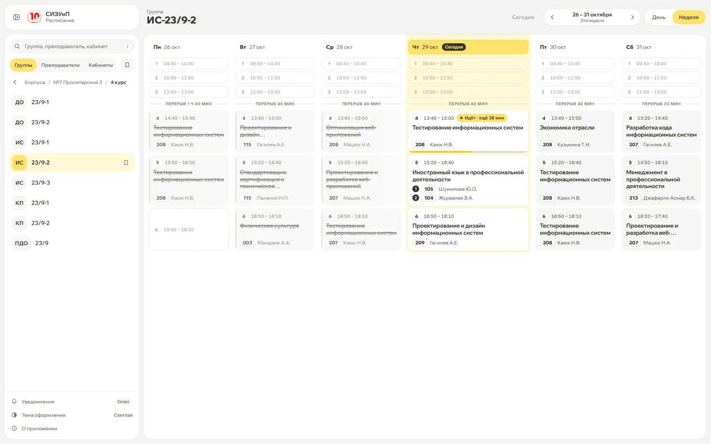
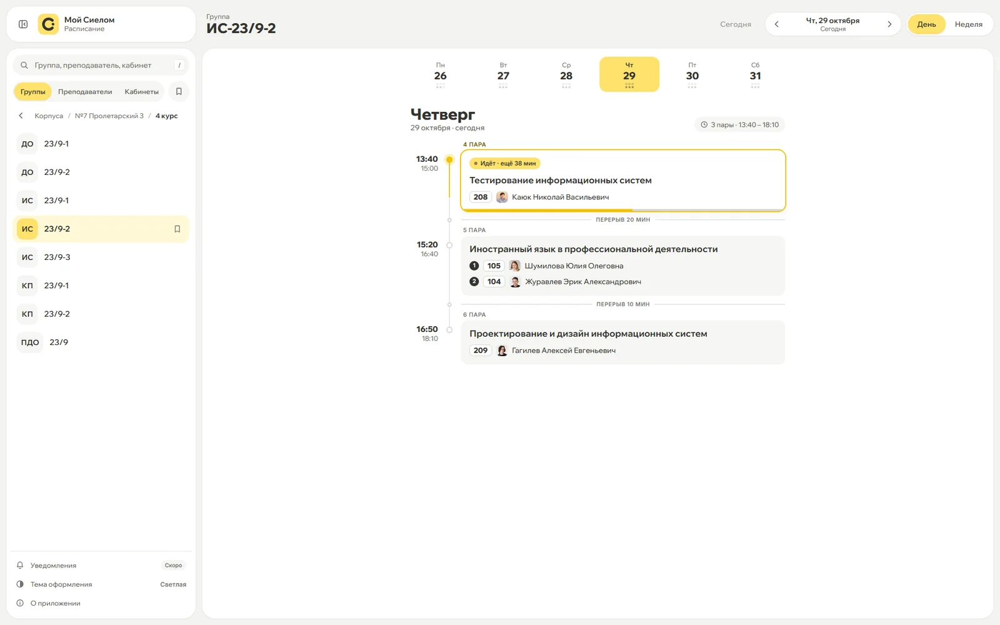
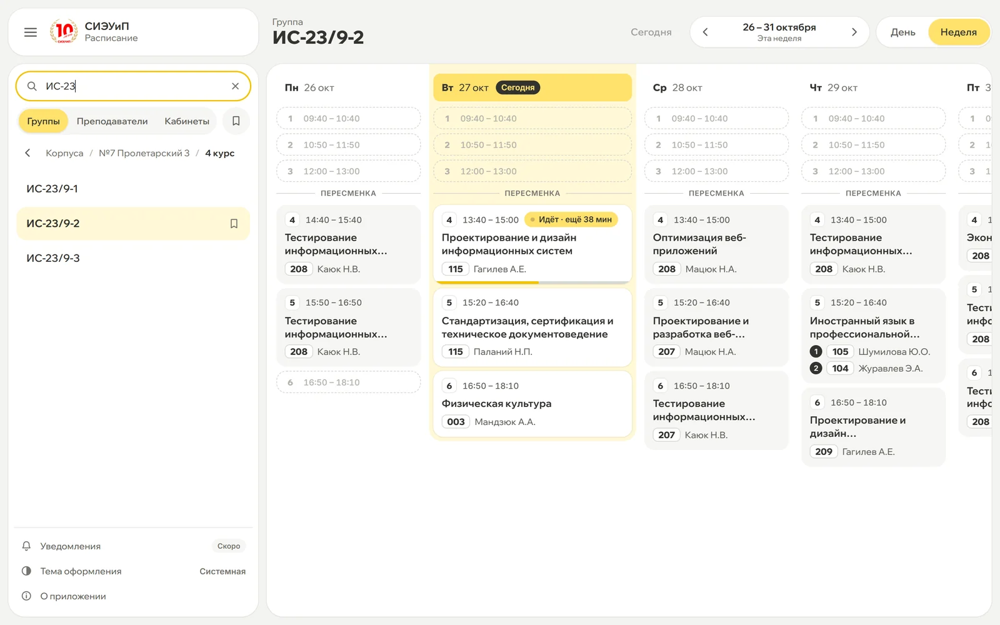
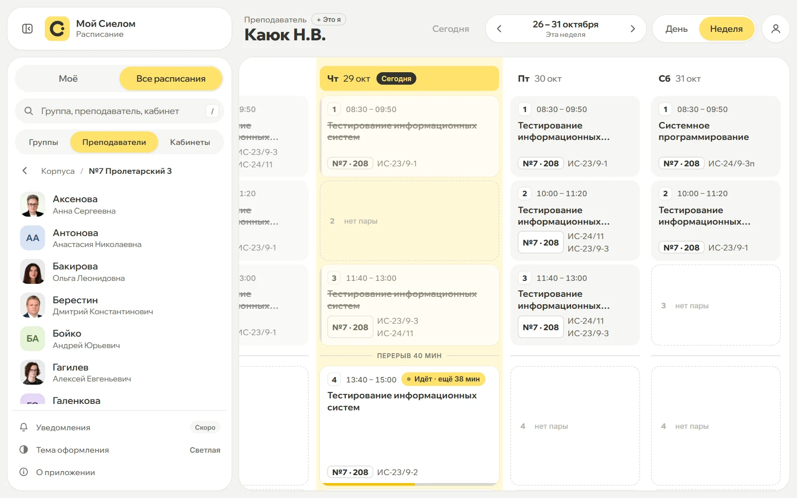
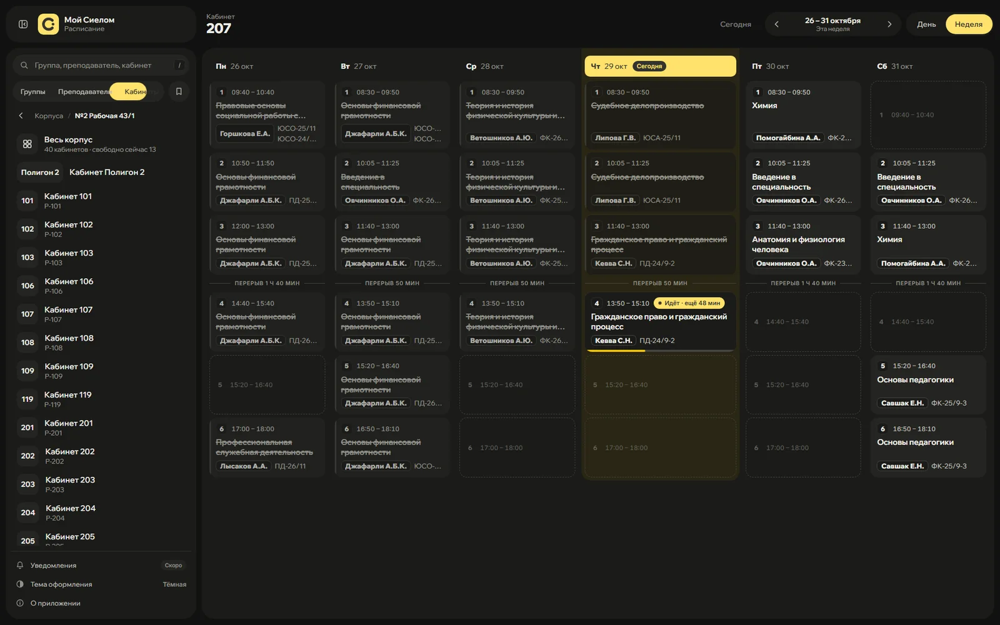
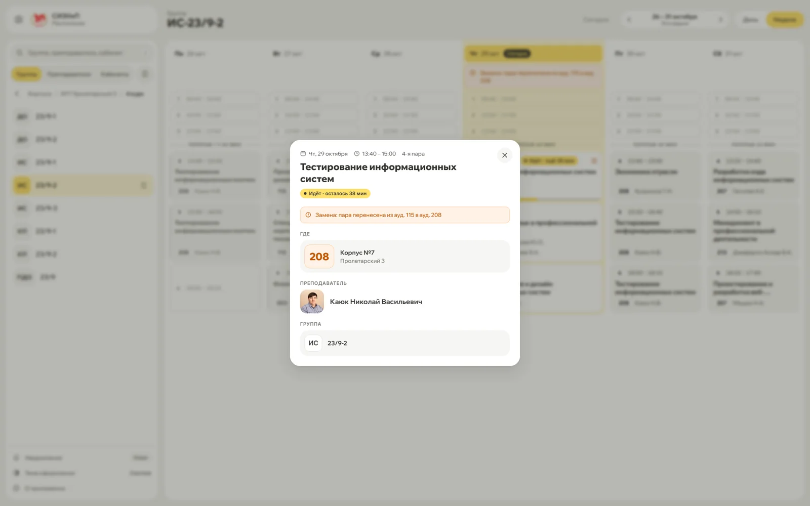
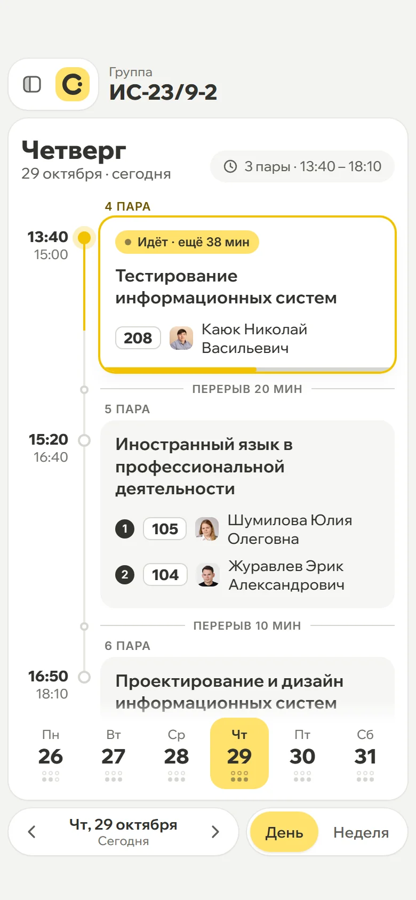
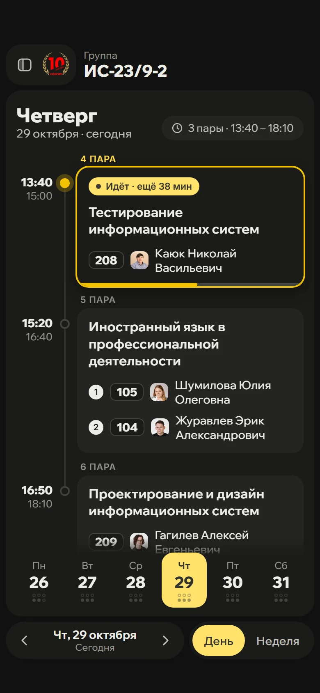
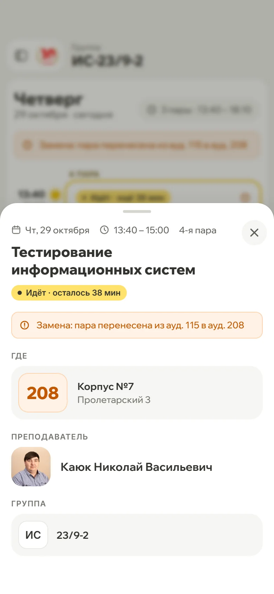
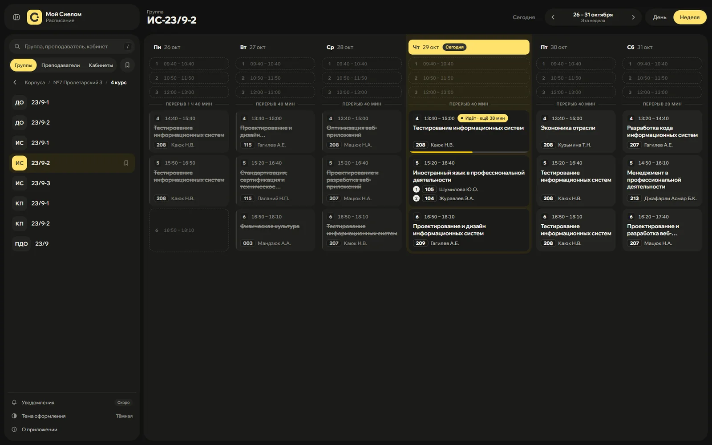

<div align="center">


# Мой Сиелом

**Неофициальный клиент расписания <a href="https://sielom.ru/"> Сургутского института экономики, управления и права</a>.**<br>
Те же данные, что на [sielom.ru/timetable](https://sielom.ru/timetable/), но с живой текущей парой, тёмной темой и нормальной мобильной версией.

[**Открыть расписание →**](https://nikkishura.github.io/my-sielom-web/) · [**Презентация проекта**](https://nikkishura.github.io/my-sielom-web/about/) · [Исходники](https://github.com/NikkiShuRA/my-sielom-web)



</div>

---

## Зачем

Официальное расписание показывает данные, и больше ничего. Оно не знает, который час, поэтому какая пара идёт и сколько до её конца, приходится считать самому. На телефоне три пустые карточки «Нет пары» занимают весь экран, тёмной темы нет, а клик по паре ничего не открывает.

Этот проект берёт те же данные из официального API и показывает их так, чтобы ответ на вопрос «куда мне сейчас идти» был виден за секунду.

## Сравнение с официальным сайтом

| | [sielom.ru/timetable](https://sielom.ru/timetable/) | Этот проект |
|---|---|---|
| Текущая пара | — | Подсветка, таймер «ещё N мин», полоса прогресса |
| Следующая пара | — | Чип «Следующая» / «Через N мин» |
| Тёмная тема | — | Системная / светлая / тёмная |
| Подробности пары | Клик ничего не делает | Аудитория, корпус с адресом, полное ФИО, группы |
| Переходы | — | Из пары сразу в расписание преподавателя или группы |
| Поиск | Выбор через корпус и курс | Мгновенный глобальный поиск по группам, преподавателям и кабинетам + навигация по корпусам |
| Горячие клавиши | — | `←` `→` `T` `/` `D` `Esc` |
| Пустые пары на телефоне | Карточки «Нет пары» на весь экран | Только реальные пары на таймлайне |
| Режимы «День» / «Неделя» | Есть | Есть |
| Избранное | Есть | Есть: группы, преподаватели и кабинеты |
| Расписание кабинетов | Есть | Есть |
| Экспорт в PDF | Есть | Пока нет |

## Возможности

### Живая текущая пара



- Текущая пара выделена, на карточке таймер «Идёт · ещё 38 мин», снизу полоса прогресса
- Следующая пара помечена «Следующая», а если до неё меньше трёх часов, то «Через N мин»
- Прошедшие пары приглушены и зачёркнуты, а на таймлайне дня по линии виден прогресс
- Между парами показан реальный перерыв («Перерыв 20 мин»), а длинный между сменами подписан отдельно
- Всё пересчитывается раз в минуту, страницу обновлять не нужно

### Два режима просмотра

- **Неделя:** сетка из шести колонок, строки одной высоты по самой высокой паре, сегодняшний день выделен, прошедшие пары приглушены и зачёркнуты, сетку можно таскать мышью
- **День:** таймлайн с полосой дней недели (точки показывают пары и окна по сменам) и сводкой «3 пары · 13:40–18:10», на телефоне дни листаются свайпом
- Отдельные состояния для «Загружаем…», «Расписание не опубликовано», «Пар нет» и ошибки сети, чтобы не путать их друг с другом

### Три вида расписаний

| Группы | Преподаватели | Кабинеты |
|---|---|---|
|  |  |  |
| Корпус → курс → группа или глобальный поиск по названию | Все пары, аудитории, группы и подгруппы | Занятость любой аудитории по корпусам |

### Подробности пары



- Аудитория, номер корпуса и его адрес
- Полное ФИО преподавателя с аватаром (фото из базы сотрудников, если оно там есть, иначе инициалы)
- Клик по преподавателю или группе открывает их расписание
- Подгруппы: если группа делится, видны обе половины со своими кабинетами и преподавателями
- Примечания о переносах и заменах помечены значком предупреждения

### Мобильная версия

<p>
  
  &nbsp;
  
  &nbsp;
  
</p>

- На телефоне по умолчанию открывается режим «День»
- Полоса дней и переключатель периода внизу, под большим пальцем
- Поиск и списки убраны в выдвижную панель, подробности пары открываются нижней шторкой
- Учтены безопасные зоны (чёлка и жест «домой»), все интерактивные элементы не меньше 44 px

### Тёмная тема

Три режима: системная, светлая и тёмная. Тема применяется до первой отрисовки, поэтому при загрузке не мелькает белый экран.



### Избранное и память

- Группы, преподаватели и кабинеты добавляются в избранное иконкой закладки, кнопка-фильтр оставляет в списке только их
- Сайт запоминает последнюю открытую группу, режим просмотра и тему
- Приложение можно установить на телефон или рабочий стол как PWA, иконка у ярлыка своя

### Горячие клавиши

| Клавиша | Действие |
|---|---|
| `←` / `→` | Предыдущий / следующий день или неделя |
| `T` | Вернуться к сегодня |
| `/` | Фокус в поиск |
| `D` | Сменить тему |
| `Esc` | Закрыть окно / очистить поиск |

## Как это устроено

```
GitHub Pages (статика)        Браузер                       sielom.ru
index.html, app.js,   ──────▶  app.js  ──────────────────▶  sielom.ru/schedule/api
styles.css, шрифты             (fetch напрямую)  ────────▶  strapi.sielom.ru/api
```

- **Без фреймворков и сборки:** HTML, CSS и ванильный JS, около 135 КБ исходников в трёх файлах (разметка, стили, логика), ноль npm-зависимостей
- **Данные напрямую из официального API**, поэтому расписание всегда такое же актуальное, как на sielom.ru
- **Без своего бэкенда:** оба API отдают CORS-заголовки, поэтому браузер обращается к ним напрямую. Сайт — чистая статика на GitHub Pages: бесплатно, без «засыпания» и открывается из РФ
- **Шрифты лежат в репозитории** ([`fonts.css`](fonts.css), [`assets/fonts/`](assets/fonts/)), никаких запросов к Google
- **Кэш:** одинаковые запросы в рамках сессии не повторяются, список сотрудников с фотографиями хранится в `localStorage` сутки

```
├── index.html            разметка приложения
├── styles.css            стили и токены тем
├── app.js                вся логика: API, рендер, навигация, избранное
├── fonts.css             локальные шрифты Inter и Wix Madefor Display
├── manifest.webmanifest  установка как PWA
├── favicon.ico, assets/  иконки приложения, шрифты, значки
├── server.js             локальный сервер для разработки
├── .github/workflows/pages.yml  деплой на GitHub Pages
└── docs/                 презентация проекта и её скриншоты (GitHub Pages)
```

## Запуск локально

Нужен только Node.js 18 или новее, зависимости ставить не надо.

```bash
git clone https://github.com/NikkiShuRA/my-sielom-web.git
cd my-sielom-web
node server.js
```

Откроется на `http://localhost:5500`. Подойдёт и любой другой статический сервер.

Каждый пуш в `master` автоматически публикуется на GitHub Pages: приложение в корне, презентация из [`docs/`](docs/) — в `/about/`.

## Презентация

В папке [`docs/`](docs/) лежит интерактивная веб-презентация проекта: демо живой пары с ползунком времени, сравнение светлой и тёмной темы, сравнение с официальным сайтом, QR-код на приложение. Она публикуется вместе с приложением: **[nikkishura.github.io/my-sielom-web/about](https://nikkishura.github.io/my-sielom-web/about/)**.

Листать можно клавишами `↓` / `Space`, тема переключается на `D`, как и в самом приложении.

## Дальше

- [ ] Уведомления о начале пары
- [ ] Экспорт в календарь
- [ ] Офлайн-режим

## Авторы

<table>
  <tr>
    <td align="center" width="160"><a href="https://github.com/NikkiShuRA"><br><b>NikkiShuRA</b></a><br><sub>автор проекта</sub></td>
    <td align="center" width="160"><a href="https://github.com/NikkiShuRA/my-sielom-web/commits/master"><br><b>Claude</b></a><br><sub>соавтор: код и вёрстка</sub></td>
  </tr>
</table>

## Лицензия

[MIT](LICENSE): код можно свободно использовать, менять и распространять. Логотип и данные расписания СИЭУиП под эту лицензию не попадают, они принадлежат институту.

---

<sub>Неофициальный проект: сделан для <a href="https://sielom.ru/">СИЭУиП</a>, но не от имени института. Все данные расписания принадлежат институту и берутся с sielom.ru.</sub>
