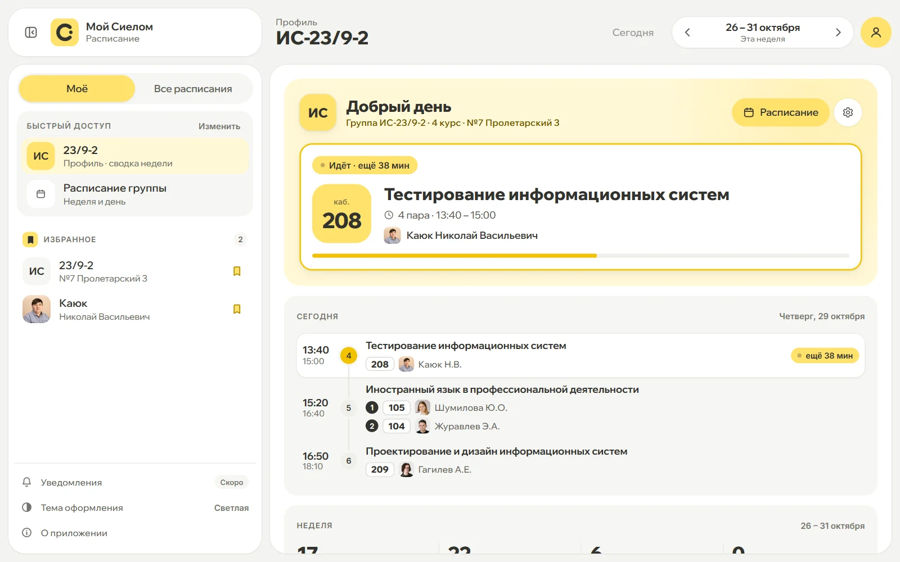
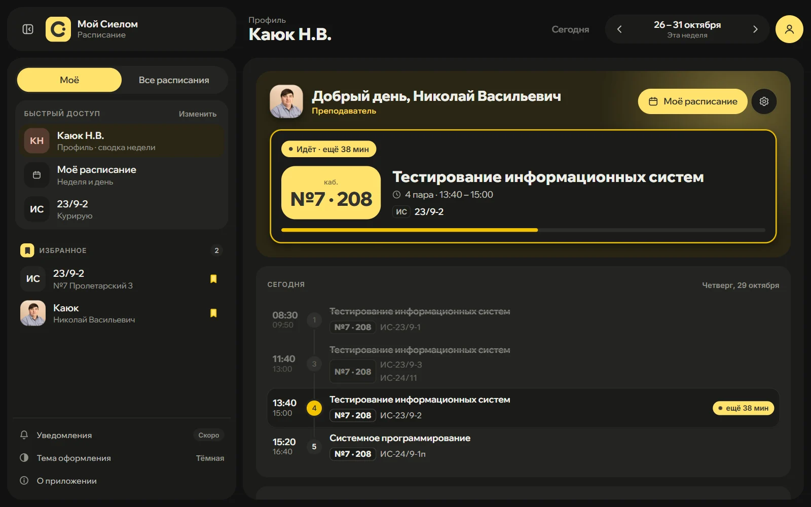
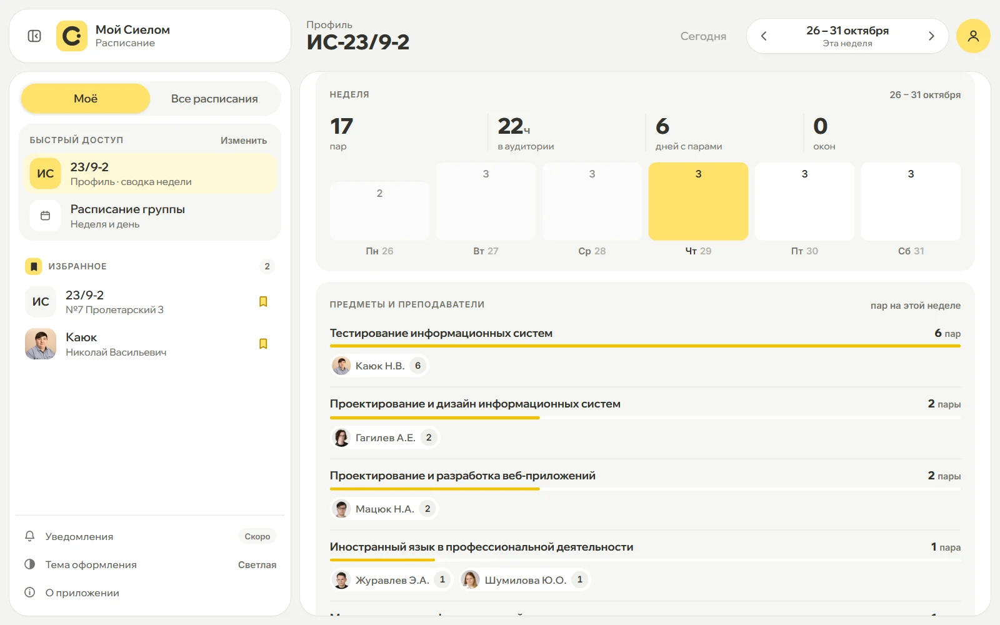
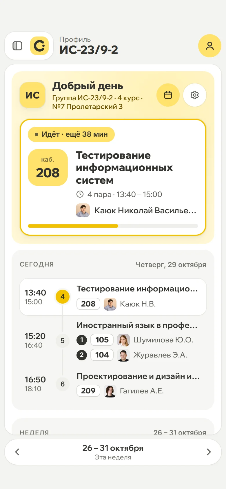

<div align="center">


# Мой Сиелом

### Открыл — и всё понятно.

**Неофициальное расписание <a href="https://sielom.ru/"> Сургутского института экономики, управления и права</a>.**<br>
Сразу твоя группа или твои пары: какая идёт, сколько осталось, в каком кабинете следующая и где в корпусе свободно.

[**Открыть расписание →**](https://nikkishura.github.io/my-sielom-web/) · [**Презентация**](https://nikkishura.github.io/my-sielom-web/about/) · [**Стенд со временем (ПК)**](https://nikkishura.github.io/my-sielom-web/demo.html)

Без регистрации · Только данные sielom.ru · Телефон и компьютер · Бесплатно и с открытым кодом



</div>

---

## Коротко

- **Профиль «Моё».** Один раз выбираете группу или себя как преподавателя, и сайт открывается сразу с вашего расписания и сводки недели. Без аккаунта.
- **Живая пара.** Что идёт сейчас, сколько осталось, что дальше. Пересчитывается каждую минуту.
- **Весь корпус.** Какие кабинеты свободны на любую пару и до какого времени.
- **Гибкий поиск.** «ис 24 9 2», «ис24/9-2» и «ис-24/9-2» находят одно и то же.
- **Ничего не додумывает.** Только данные из API колледжа. Странности в расписании видны как есть.
- **Удобно везде.** Мобильная версия под большой палец, тёмная тема, установка как приложение.

## Зачем

Официальное расписание показывает данные, и больше ничего. Оно не знает, который час, поэтому какая пара идёт и сколько до её конца, приходится считать самому. На телефоне три пустые карточки «Нет пары» занимают весь экран, тёмной темы нет, клик по паре ничего не открывает, а чтобы найти свободную аудиторию, нужно перебирать кабинеты по одному.

«Мой Сиелом» берёт те же данные из официального API и отвечает на три вопроса за секунду: **куда мне сейчас идти, что у меня на неделе и где сейчас свободно.**

## Сравнение с официальным сайтом

| | [sielom.ru/timetable](https://sielom.ru/timetable/) | Мой Сиелом |
|---|---|---|
| Своё расписание при входе | — | Профиль без регистрации, своя главная страница |
| Сводка недели | — | Пары, часы в аудитории, дни, окна, предметы |
| Текущая пара | — | Подсветка, таймер «ещё N мин», полоса прогресса |
| Следующая пара | — | Чип «Следующая» / «Через N мин» |
| Свободные кабинеты | — | Табло и шахматка всего корпуса, «Свободно N из M» |
| Тёмная тема | — | Системная / светлая / тёмная |
| Подробности пары | Клик ничего не делает | Кабинет, корпус с адресом, полное ФИО, группы |
| Переходы | — | Из пары сразу в расписание преподавателя или группы |
| Поиск | Выбор через корпус и курс | Единый и гибкий: «ис 24 9 2» |
| Горячие клавиши | — | `←` `→` `T` `/` `D` `Esc` |
| Пустые пары на телефоне | Карточки «Нет пары» на весь экран | Только реальные пары и окна |
| Режимы «День» / «Неделя» | Есть | Есть |
| Избранное | Есть | Есть: группы, преподаватели и кабинеты |
| Расписание кабинетов | Есть | Есть, плюс «Весь корпус» одним экраном |
| Экспорт в PDF | Есть | Пока нет |

## Возможности

### Профиль «Моё»

Укажите, кто вы, и сайт будет открываться с вашего расписания.

| Студент | Преподаватель | Неделя |
|---|---|---|
|  |  |  |
| Идущая пара, кабинет, таймер и пары на сегодня | Свои пары и группы, карточка курируемой группы | Пары, часы, дни, окна и предметы с преподавателями |

- **Студент** выбирает свою группу. **Преподаватель** выбирает себя и, если он куратор, свои кураторские группы
- **Сегодня:** что идёт сейчас и сколько осталось, а если пар уже нет, то когда ближайшая
- **Неделя:** число пар, часы в аудитории, дни с парами и окна; столбики по дням открывают нужный день
- **Предметы и люди:** у каждого предмета видно, с какими преподавателями (или группами) и сколько пар на этой неделе
- **Курируемая группа:** где она сейчас и есть ли на неделе пары с примечаниями о переносах
- **Своя главная страница:** профиль (по умолчанию), своё расписание, курируемая группа или последнее открытое
- Вкладки боковой панели **«Моё»** и **«Все расписания»**: быстрый доступ и избранное отдельно от поиска
- **Без аккаунта:** профиль хранится только в вашем браузере, никто другой его не видит и не может изменить

### Живая текущая пара


- Текущая пара выделена, на карточке таймер «Идёт · ещё 38 мин», снизу полоса прогресса
- Следующая пара помечена «Следующая», а если до неё меньше трёх часов, то «Через N мин»
- Прошедшие пары приглушены и зачёркнуты, а на линии дня виден прогресс
- Между парами — реальный перерыв по времени соседних пар («Перерыв 20 мин»), окна подписаны свободным промежутком
- Всё пересчитывается раз в минуту, страницу обновлять не нужно

### Два режима просмотра

- **Неделя:** сетка из шести колонок, пары с одним номером на одной линии, сегодняшний день выделен, сетку можно таскать мышью
- **День:** лента с полосой дней (точки показывают пары и окна) и сводкой «3 пары · 13:40 – 18:10», на телефоне дни листаются свайпом
- Отдельные состояния для «Загружаем…», «Расписание ещё не опубликовано», «Пар нет» и ошибки сети, чтобы их нельзя было перепутать

### Группы, преподаватели, кабинеты

| Группы | Преподаватели | Кабинеты |
|---|---|---|
|  |  |  |
| Корпус → курс → группа или поиск по названию | Все пары, кабинеты, группы и подгруппы | Занятость любой аудитории по корпусам |

Если пары за неделю идут в нескольких корпусах, рядом с кабинетом стоит номер корпуса («№7 · 208»), чтобы не перепутать здания.

### Весь корпус: где сейчас свободно

Выберите в списке кабинетов пункт «Весь корпус», и откроется сводка по всем аудиториям здания.


- **Шахматка:** кабинеты × пары дня на одном экране. Колонка идущей пары подсвечена, прогресс бежит по её заголовку. Кабинет, где ещё идёт предыдущая пара, помечен «Занят до 18:10»
- **Свободные:** выберите пару, и видно, какие кабинеты свободны и до какого времени, а у занятых — кто и с кем
- **«Свободно 4 из 21»** считается для идущей пары, а между парами для ближайшей, по кабинетам из расписания этой недели
- Фильтры по этажам, «только свободные» и поиск, который подсвечивает пары нужной группы или преподавателя
- На телефоне пары лентой внизу, «Свободные» плитками, свайп листает пары и недели


### Гибкий поиск

- Знаки между частями названия не важны: **«ис 24 9 2»**, **«ис24/9-2»** и **«ис-24/9-2»** находят одну и ту же группу
- Если точного совпадения нет, запрос разбивается на слова: «мандзюк ис» найдёт пары преподавателя с группой ИС
- Работает и в боковой панели, и в шахматке корпуса

### Подробности пары


- Кабинет, номер корпуса и его адрес
- Полное ФИО преподавателя с фото из базы сотрудников (или инициалами)
- Клик по преподавателю или группе открывает их расписание
- Подгруппы: обе половины группы со своими кабинетами и преподавателями, а если у них разные предметы, у каждой свой блок
- Примечания о переносах и заменах: значок на карточке, плашка в подробностях, подсвеченный кабинет

### Ничего не додумывает

На сайте только данные из API колледжа и простая арифметика по ним. Если в расписании странность, вы увидите её как есть.

| В API | На сайте |
|---|---|
| 6-я пара 16:50–18:10, 7-я 18:00–19:20 | «Пары пересекаются на 10 мин» вместо выдуманного перерыва |
| У групп одного номера пары разное время | Оба варианта: «13:40 – 15:00 / 13:50 – 15:10» |
| Пары под номером нет | «нет пары» без времени и «Окно · свободно 11:20 – 13:40» по соседним парам |
| Преподаватель «ВАКАНСИЯ» | «Преподаватель не назначен», в поиске такого человека нет |
| Подгруппы с разными предметами | У каждой подгруппы свой предмет, кабинет и преподаватель |
| Неделя опубликована не для всех корпусов | «Расписание ещё не опубликовано», а не «пар нет» |
| Пара без названия предмета | «Предмет не указан» |

### Мобильная версия

<p>
  
  &nbsp;
  
  &nbsp;
  
  &nbsp;
  
</p>

- На телефоне первым открывается профиль, а расписание — в режиме «День»
- Полоса дней и переключатель недели внизу, под большим пальцем
- Поиск и списки убраны в выдвижную панель, подробности пары открываются нижней шторкой
- Учтены безопасные зоны (чёлка и жест «домой»), все интерактивные элементы не меньше 44 px
- Сайт можно установить на телефон или компьютер как приложение (PWA)

### Тёмная тема

Системная, светлая и тёмная. Тема применяется до первой отрисовки, поэтому при загрузке не мелькает белый экран.


### Избранное и память

- Группы, преподаватели и кабинеты добавляются в избранное иконкой закладки и живут во вкладке «Моё»
- Сайт запоминает последнюю открытую страницу, режим просмотра и тему

### Горячие клавиши

| Клавиша | Действие |
|---|---|
| `←` / `→` | Предыдущий / следующий день или неделя |
| `T` | Вернуться к сегодня |
| `/` | Фокус в поиск |
| `D` | Сменить тему |
| `Esc` | Закрыть окно / очистить поиск |

## Стенд: потрогайте сами

**[nikkishura.github.io/my-sielom-web/demo.html](https://nikkishura.github.io/my-sielom-web/demo.html)** — настоящее приложение в рамке телефона, планшета или ноутбука, где можно подменять время и сценарии данных. Рассчитан на компьютер: на телефоне показывается пояснение.

<a href="https://nikkishura.github.io/my-sielom-web/demo.html"></a>

- **Время:** ползунок на 24 часа, быстрые точки («Перед парами», «Идёт 4 пара», «Между сменами», «Ночь»), выбор дня недели и ход часов до 20 минут в секунду
- **Экран:** телефон, планшет, ноутбук и широкий монитор
- **Тема и вид:** системная, светлая, тёмная; неделя или день
- **Что показать:** группа или весь корпус; всё остальное выбирается в самом приложении
- **Сценарии:** загрузка, ошибка сети, «не опубликовано», «пар нет» и примечание у 4 пары
- **Готовое состояние по ссылке:** например `demo.html?t=14:22&d=3&subject=building&theme=dark&device=wide`. Параметры: `t` — время, `d` — день (0 это пн), `subject` — `group` или `building`, `theme`, `view`, `device` — `phone`, `tablet`, `laptop`, `wide`, `mode` — `ok`, `loading`, `error`, `unpublished`, `empty`

Стенд не трогает ваш профиль и избранное: всё, что меняется внутри рамки, живёт только в ней.

## Как это устроено

```
GitHub Pages (статика)        Браузер                       sielom.ru
index.html, app.js,   ──────▶  app.js  ──────────────────▶  sielom.ru/schedule/api
styles.css, шрифты             (fetch напрямую)  ────────▶  strapi.sielom.ru/api
```

- **Без фреймворков и сборки:** HTML, CSS и ванильный JS, около 270 КБ исходников, ноль npm-зависимостей
- **Данные напрямую из официального API**, поэтому расписание всегда такое же актуальное, как на sielom.ru
- **Без своего бэкенда:** оба API отдают CORS-заголовки, и браузер обращается к ним напрямую. Сайт — статика на GitHub Pages: бесплатно, без «засыпания» и открывается из РФ
- **Приватность:** ни аккаунтов, ни аналитики. Профиль, избранное и настройки лежат в `localStorage` вашего браузера
- **Шрифты лежат в репозитории** ([`fonts.css`](fonts.css), [`assets/fonts/`](assets/fonts/)), никаких запросов к Google, в том числе из презентации
- **Кэш:** одинаковые запросы в рамках сессии не повторяются, список сотрудников с фото хранится в `localStorage` сутки

```
├── index.html            разметка приложения
├── styles.css            стили и токены тем
├── app.js                вся логика: API, рендер, профиль, навигация, избранное, корпус
├── fonts.css             локальные шрифты Inter и Wix Madefor Display
├── demo.html             стенд: приложение в рамке устройства с подменой времени
├── manifest.webmanifest  установка как PWA
├── favicon.ico, assets/  иконки приложения, шрифты, значки
├── server.js             локальный сервер для разработки
├── .github/workflows/pages.yml  деплой на GitHub Pages
└── docs/                 презентация проекта и её скриншоты
```

## Запуск локально

Нужен только Node.js 18 или новее, зависимости ставить не надо.

```bash
git clone https://github.com/NikkiShuRA/my-sielom-web.git
cd my-sielom-web
node server.js
```

Откроется на `http://localhost:5500`, стенд на `http://localhost:5500/demo.html`, презентация на `http://localhost:5500/docs/`. Подойдёт и любой другой статический сервер.

Каждый пуш в `master` автоматически публикуется на GitHub Pages: приложение и стенд в корне, презентация из [`docs/`](docs/) — в `/about/`.

## Презентация

**[nikkishura.github.io/my-sielom-web/about](https://nikkishura.github.io/my-sielom-web/about/)** — интерактивная история проекта: профиль «Моё», живая пара с ползунком времени, сравнение светлой и тёмной темы, «Весь корпус», примеры того, как сайт показывает странности расписания, сравнение с официальным сайтом и QR-код на приложение.

Листать можно клавишами `↓` / `Space`, тема переключается на `D`, как и в самом приложении.

## Дальше

- [ ] Уведомления о начале пары
- [ ] Экспорт в календарь
- [ ] Офлайн-режим

## Авторы

<table>
  <tr>
    <td align="center" width="160"><a href="https://github.com/NikkiShuRA"><br><b>NikkiShuRA</b></a><br><sub>автор проекта</sub></td>
    <td align="center" width="160"><a href="https://github.com/NikkiShuRA/my-sielom-web/commits/master"><br><b>Claude</b></a><br><sub>соавтор: код и вёрстка</sub></td>
  </tr>
</table>

## Лицензия

Copyright © 2026 NikkiShuRA. Код распространяется по [GNU AGPL версии 3 или любой более поздней](LICENSE) (`AGPL-3.0-or-later`): его можно свободно использовать, менять и распространять, но изменённую версию нужно открыть под той же лицензией, в том числе если она работает как сайт или сервис для других людей. Если вы запускаете свою версию, оставьте в ней ссылку «Исходный код» на свои исходники.

Под эту лицензию не попадают:

- шрифты [Inter](https://github.com/rsms/inter) и [Wix Madefor Display](https://github.com/wix/wixmadefor) в [`assets/fonts/`](assets/fonts/) — они распространяются по [SIL Open Font License 1.1](https://openfontlicense.org/);
- логотип и данные расписания СИЭУиП — они принадлежат институту.

---

<sub>Неофициальный проект: сделан для <a href="https://sielom.ru/">СИЭУиП</a>, но не от имени института. Все данные расписания принадлежат институту и берутся с sielom.ru.</sub>
